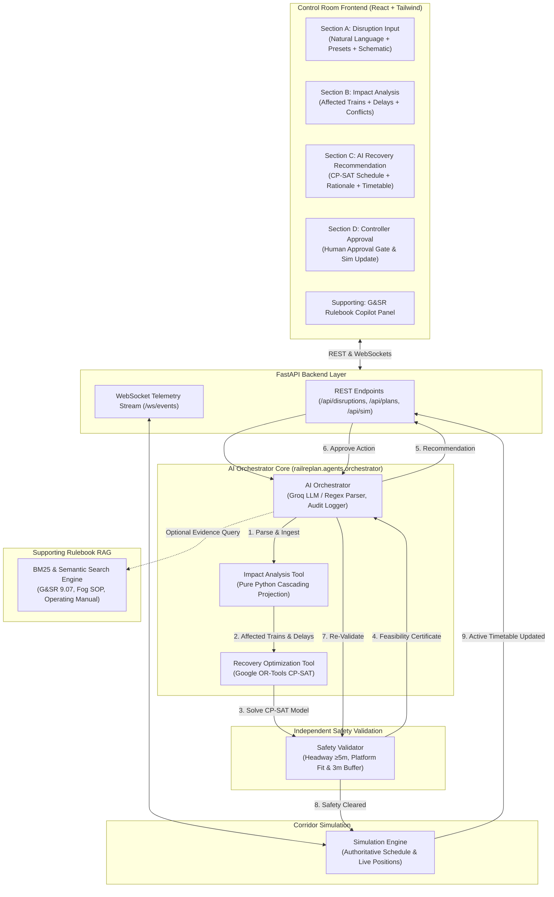

# 🚂 RailReplan AI — System Architecture & Technical Specifications

## 1. Architectural Principles

RailReplan AI is designed as a focused, high-reliability Railway Disruption Recovery Agent adhering to strict architectural boundaries:

1. **Separation of Reasoning and Mathematical Optimization**:
   - Natural language comprehension, rulebook evidence grounding, and human-facing explanations are handled by the **AI Orchestrator**.
   - Timetable replanning and constraint satisfaction are solved mathematically by **Google OR-Tools CP-SAT** (`RecoveryOptimizationTool`). No LLM hallucinated schedules.
2. **Deterministic Independent Safety Gate**:
   - The **Safety Validator** (`SafetyValidator`) runs independently outside the solver and orchestrator.
   - Verifies track occupancy headway (≥ 5 min), platform berthing clearance (3 min buffer), and usable physical platform lengths.
   - If any hard constraint fails, the plan cannot be approved or committed to the simulator.
3. **Single Authoritative State**:
   - The simulator maintains the single source of truth for train schedules, active speed restrictions, and route blockages.
   - Only approved and safety-revalidated plans update the simulation state.
4. **No Artificial Complexity**:
   - No multi-agent negotiation auctions, fake consensus scores, Marey diagram generators, fleet matrices, crew rosters, or passenger SMS modules.

---

## 2. System Architecture Diagram

---

## 3. End-to-End Recovery Pipeline

### Step 1: Disruption Ingestion & Parsing
- Input: Controller reports an incident in natural language (e.g. *"Heavy fog near Agra Cantt for 60 minutes reducing speeds to 45 km/h"*).
- `AIOrchestrator` invokes `_parse_disruption_text()`:
  - Uses Groq LLM (`openai/gpt-oss-120b`) with a structured schema prompt.
  - Automatically falls back to deterministic regex pattern matching if the LLM API is unavailable.
  - Output: Structured disruption object with `type`, `station_id`, `duration_minutes`, `speed_limit_kmh`, `direction`, and `start_time`.

### Step 2: Impact Analysis
- `ImpactAnalysisTool.analyze()`:
  - Scans active trains on the corridor (NDLS-BPL, 702 km, 9 stations).
  - Filters trains traversing the affected station within `[start_time, start_time + duration]`.
  - Calculates unmitigated cascading delays:
    $$\Delta t_{\text{delay}} = \text{slowdown loss} + \text{propagation to downstream stations}$$
  - Detects section headway breaches (< 5 min) and station platform overlaps.

### Step 3: CP-SAT Optimization
- `RecoveryOptimizationTool.optimize()`:
  - Variables: For each affected train $i$ and station $s$, integer decision variables for arrival time $A_{i,s}$ and departure time $D_{i,s}$ in minutes from corridor base time.
  - Hard Constraints:
    - **Minimum Dwell**: $D_{i,s} - A_{i,s} \ge \text{min\_dwell}_{i,s}$.
    - **Disrupted Runtime**: Between stations affected by the speed limit, running time is stretched according to $v_{\text{limit}}$.
    - **Section Headway**: $|D_{i,s} - D_{j,s}| \ge 5\text{ min}$ for same-direction movements.
    - **Platform Conflict Avoidance**: For trains assigned to the same platform $p$ at station $s$, $[A_{i,s}, D_{i,s}]$ and $[A_{j,s}, D_{j,s}]$ must not overlap (3 min buffer enforced).
    - **Headway Against Fixed Traffic**: Retimed trains maintain ≥ 5 min headway against unaffected trains on the corridor.
  - Objective Function:
    $$\min \sum_{i} \left( w_i \cdot \text{delay}_{i,\text{final}} + \sum_s \text{penalty}(\text{dwell variance}) \right)$$
  - Solves to proven mathematical optimality using Google OR-Tools CP-SAT in 0.04–0.08 seconds.

### Step 4: Independent Safety Validation
- `SafetyValidator.validate_plan()`:
  - Performs independent verification on the proposed plan before it is shown to the controller:
    1. **Headway Check**: Verifies all adjacent departures maintain $\ge 5$ minutes clearance.
    2. **Platform Berthing Check**: Verifies no two trains occupy the same platform simultaneously (min 3 min separation).
    3. **Platform Physical Fit**: Verifies train rake length $\le$ platform usable length.
    4. **Dwell Feasibility**: Verifies no negative dwells or impossible turnarounds.
  - Generates a hard pass/fail certification and warning breakdown.

### Step 5: Decision Explanation & RAG Grounding
- `AIOrchestrator._generate_explanation()`:
  - Explains the trade-offs (e.g. holding freight train to grant priority clearance to Vande Bharat / Rajdhani Express).
  - Cites Indian Railways General & Subsidiary Rules (G&SR 9.07 — Automatic Block Working during Fog, Fog SOP 2024 speed caps).
  - Packages the solution into a structured recommendation for the controller.

### Step 6: Controller Approval Gate & Simulator Commit
- The controller reviews the impact and proposed timetable in the UI.
- When the controller clicks **"Approve Recovery Plan"**:
  - Backend `/api/plans/{id}/approve` endpoint calls `orchestrator.approve_plan()`.
  - The plan is **re-validated** by `SafetyValidator`. If any constraint fails, approval is blocked.
  - Once validated, the plan is committed to `SimulationEngine.active_schedule`.
  - The simulation timeline updates immediately, broadcasting a `SIM_UPDATE` event over WebSocket.
  - An immutable record is appended to the audit log.

---

## 4. Corridor Topology (Authoritative)

The simulated corridor covers the 702 km North Central Railway main trunk route:

| Station Code | Station Name | KM Post | Lines | Platforms | Speed Limit |
|---|---|---|---|---|---|
| **NDLS** | New Delhi | 0.0 | Double | 16 | 130 km/h |
| **MTJ** | Mathura Junction | 141.0 | Double | 10 | 130 km/h |
| **AGC** | Agra Cantt | 195.0 | Double | 6 | 130 km/h |
| **GWL** | Gwalior Junction | 313.0 | Double | 4 | 130 km/h |
| **JHS** | Virangana Lakshmibai (Jhansi) | 410.0 | Double | 8 | 130 km/h |
| **BINA** | Bina Junction | 563.0 | Double | 5 | 130 km/h |
| **BPL** | Bhopal Junction | 702.0 | Double | 6 | 130 km/h |

All metrics, headway checks, and timetable adjustments adhere strictly to this physical layout.
